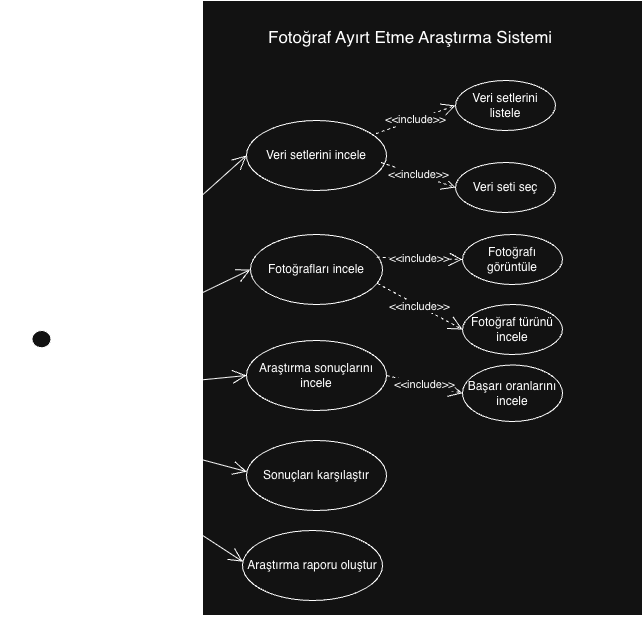
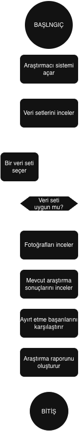

ai-fotograf-arastirmasi

Projenin Amacı

Bu projede insanların gerçek fotoğraflar ile yapay zekâ tarafından oluşturulan fotoğrafları ayırt etme başarısı incelenecektir.

Araştırma Yöntemi

Katılımcılara gerçek ve yapay zekâ tarafından oluşturulan fotoğraflar gösterilecek, hangi fotoğrafların gerçek olduğunu tahmin etmeleri istenecektir.

Veri Toplama

Katılımcıların cevapları Google Forms aracılığıyla toplanacaktır.

Veri Analizi

Cevaplar incelenerek katılımcıların doğru tahmin oranları hesaplanacaktır.
-------------------------------------------------------------------------------------
UML Diyagramları

Aşağıdaki diyagramlar, Fotoğraf Ayırt Etme Araştırma Sistemi'nin yapısını ve araştırma sürecinin işleyişini göstermek amacıyla hazırlanmıştır.

1. Kullanım Durumu Diyagramı

Sistemin temel kullanıcısı olan araştırmacının gerçekleştirebileceği işlemleri gösterir. Araştırmacı veri setlerini inceleyebilir, fotoğrafları görüntüleyebilir, mevcut araştırma sonuçlarını inceleyebilir ve sonuçları karşılaştırarak rapor oluşturabilir.

2. Aktivite Diyagramı

Araştırma sürecinin adımlarını gösterir. Veri setlerinin incelenmesi, uygun veri setinin seçilmesi, fotoğrafların ve mevcut araştırma sonuçlarının incelenmesi, sonuçların karşılaştırılması ve rapor oluşturulması aşamalarını içerir.

3. Sınıf Diyagramı

Sistemin temel sınıflarını, özelliklerini, metotlarını ve aralarındaki ilişkileri gösterir. Araştırmacı, VeriSeti, Fotograf, ArastirmaSonucu ve Rapor sınıfları sistemin temel yapısını oluşturur.

Proje Durumu

Bu proje, Yazılım Mühendisliği Temelleri dersi kapsamında sistemin kodlama aşamasından önce modellenmesi amacıyla hazırlanmıştır. UML diyagramları ile sistemin işleyişi ve yapısı açıklanmıştır.

